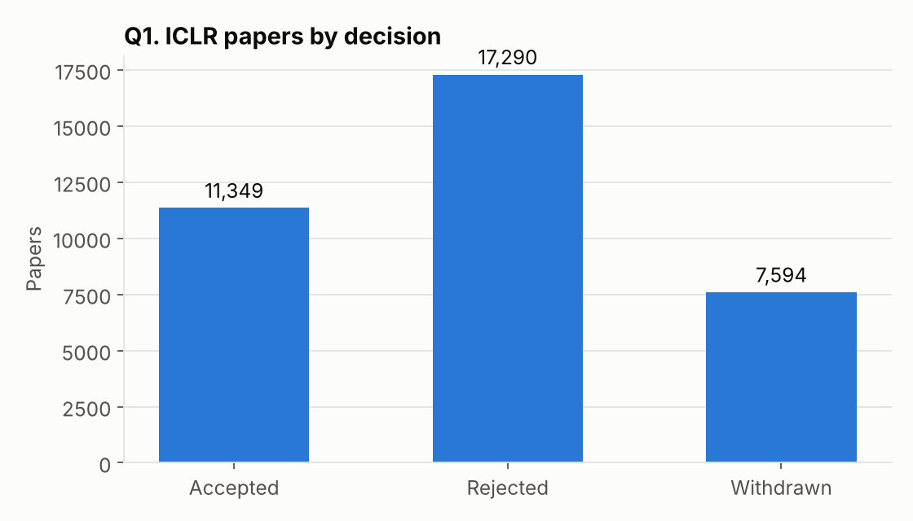
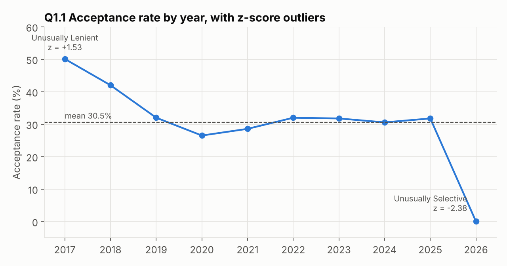
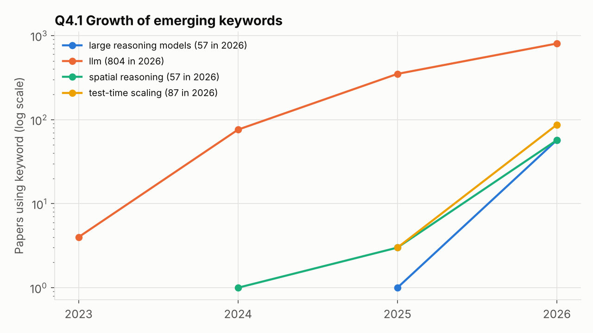
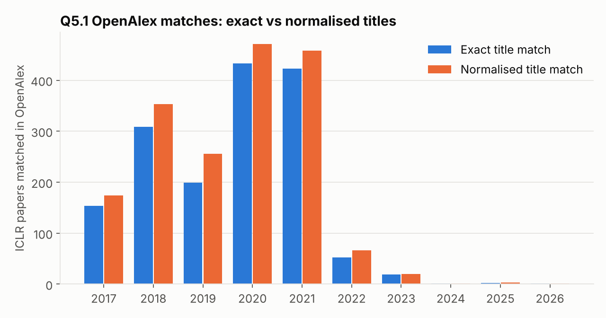
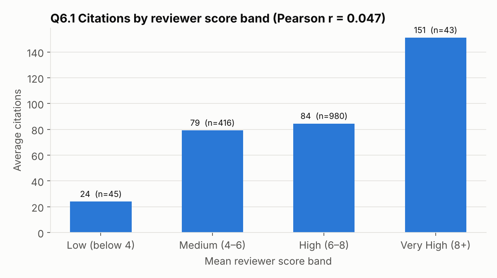

# Big Data Analytics: ICLR Peer Review and Citation Analysis

A PySpark analysis, run on Databricks, of **55,906 ICLR submissions (2017–2026)** joined with **2,245 OpenAlex citation records**. It looks at review outcomes, reviewer score disagreement, top-rated papers, emerging research keywords, and whether reviewer scores predict long-term citation impact.

## Key findings

- **Outcomes:** 17,290 papers rejected, 11,349 accepted and 7,594 withdrawn.
- **Acceptance rate:** stable at about 30% from 2019 to 2025. 2017 was unusually lenient (50.1%, z = +1.53). The 2026 rate is 0% only because no 2026 decisions are in the data yet (z = −2.38).
- **Reviewer disagreement:** 1,596 accepted papers received at least one score below 5.
- **Top papers:** the top mean score is 10.0, with all reviewers agreeing (std dev 0). Most of the top 10 have a std dev near 1, so their rankings reflect consensus rather than one inflated score.
- **Emerging keywords:** "llm" rose from 4 papers in 2023 to 804 in 2026. "test-time scaling", "spatial reasoning" and "large reasoning models" each grew by thousands of per cent in 2026.
- **Data linkage:** normalising titles before the join recovered up to 57 extra OpenAlex matches per year.
- **Scores vs citations:** almost no linear relationship (Pearson r = 0.047), although papers scoring 8+ do average the most citations (151).

## Repository structure

```
├── code/
│   ├── big_data_analytics_iclr.py    # Full PySpark analysis (plain-Python export of the notebook)
│   └── make_figures.py               # Builds the charts in figures/ from results/
├── data/
│   ├── iclr26v1.parquet              # ICLR submissions: scores, decisions, keywords
│   └── openalex.json                 # OpenAlex citation metadata
├── figures/                          # Charts (PNG)
├── notebooks/
│   ├── Big_Data_Analytics_ICLR.ipynb # Databricks notebook with outputs
│   └── Big_Data_Analytics_ICLR.html  # Rendered HTML export
├── report/
│   └── Big_Data_Analytics_ICLR_Report.pdf
└── results/                          # Every result table as CSV, plus summary_stats.txt
```

## Results

### Q1. Accepted, rejected and withdrawn papers



Raw decision labels such as "Accept (Poster)", "Accept: notable-top-5%" and "Invite to Workshop Track" were standardised into accepted / rejected / withdrawn ([mapping](results/00_decision_label_mapping.csv)).

**Extension (z-score of annual acceptance rates):**



| Year | Submissions | Accepted | Rate (%) | z-score | Classification |
|---|---|---|---|---|---|
| 2017 | 489 | 245 | 50.10 | 1.530 | Unusually Lenient |
| 2018 | 1,012 | 425 | 42.00 | 0.897 | Normal Range |
| 2019 | 1,569 | 502 | 31.99 | 0.115 | Normal Range |
| 2020 | 2,593 | 687 | 26.49 | −0.315 | Normal Range |
| 2021 | 3,009 | 859 | 28.55 | −0.154 | Normal Range |
| 2022 | 3,422 | 1,094 | 31.97 | 0.114 | Normal Range |
| 2023 | 4,955 | 1,573 | 31.75 | 0.097 | Normal Range |
| 2024 | 7,401 | 2,261 | 30.55 | 0.003 | Normal Range |
| 2025 | 11,663 | 3,703 | 31.75 | 0.097 | Normal Range |
| 2026 | 120 | 0 | 0.00 | −2.384 | Unusually Selective |

### Q2. Accepted papers with at least one low score (< 5)

**1,596** accepted papers had at least one reviewer score below 5.

**Extension (min–max normalised mean score tiers):**

| Tier | Papers | Avg raw score | Avg normalised score |
|---|---|---|---|
| Upper | 117 | 6.75 | 0.752 |
| Mid | 1,392 | 5.65 | 0.566 |
| Lower | 87 | 4.31 | 0.338 |

### Q3. Top 10 papers by mean score

**Extension (score variance), to check consensus versus outlier inflation:**

| Paper ID | Year | Mean score | Std dev | Reviewers |
|---|---|---|---|---|
| u1cQYxRI1H | 2025 | 10.00 | 0.000 | 4 |
| Sy8gdB9xx | 2017 | 9.67 | 0.577 | 3 |
| 6Mxhg9PtDE | 2025 | 9.50 | 1.000 | 4 |
| 88nT0j5jAn | 2023 | 9.33 | 1.155 | 3 |
| LyJi5ugyJx | 2025 | 9.20 | 1.095 | 5 |
| aN4Jf6Cx69 | 2024 | 9.00 | 1.155 | 4 |
| DJSZGGZYVi | 2025 | 9.00 | 1.095 | 6 |
| b-ny3x071E5 | 2022 | 9.00 | 1.155 | 4 |
| lTt4KjHSsyl | 2023 | 9.00 | 1.155 | 4 |
| WCRQFlji2q | 2025 | 9.00 | 1.155 | 4 |

### Q4. Rapidly increasing keywords

These keywords went from fewer than 5 papers in one year to more than 50 the next:

| Keyword | Year | Count | Following year | Count |
|---|---|---|---|---|
| test-time scaling | 2025 | 3 | 2026 | 87 |
| llm | 2023 | 4 | 2024 | 76 |
| spatial reasoning | 2025 | 3 | 2026 | 57 |
| large reasoning models | 2025 | 1 | 2026 | 57 |

**Extension (full growth trajectory):**



### Q5. ICLR papers with OpenAlex information

**Extension (impact of title normalisation on matches):**



| Year | Exact matches | Normalised matches | Additional |
|---|---|---|---|
| 2017 | 154 | 174 | 20 |
| 2018 | 309 | 353 | 44 |
| 2019 | 199 | 256 | 57 |
| 2020 | 433 | 471 | 38 |
| 2021 | 423 | 458 | 35 |
| 2022 | 52 | 66 | 14 |
| 2023 | 19 | 20 | 1 |
| 2024–2026 | 4 | 5 | 1 |

### Q6. Low-score but highly cited papers

**13 papers** (2017–2020) had a mean reviewer score below 5 but reached the top 5% of citations (95th percentile = 299 citations). See [the full list](results/q6_low_score_highly_cited.csv).

**Extension (Pearson correlation and score bands):**



Pearson r between mean reviewer score and citation count is **0.047**, which means reviewer scores have almost no linear relationship with long-term citations.

## Tech stack

PySpark (DataFrames, `pyspark.sql.functions`, window functions, joins, `approxQuantile`, `corr`), Databricks (serverless compute, Unity Catalog volumes), and pandas and matplotlib for the charts.

## Running it

1. Upload `data/iclr26v1.parquet` and `data/openalex.json` to a Databricks volume.
2. Open `notebooks/Big_Data_Analytics_ICLR.ipynb` (or `code/big_data_analytics_iclr.py`) and set `ICLR_PATH` and `OPENALEX_PATH` in the first code cell to your volume paths.
3. Run all cells.
4. To rebuild the charts locally, run `pip install pandas matplotlib`, then `python code/make_figures.py` from the repo root.
